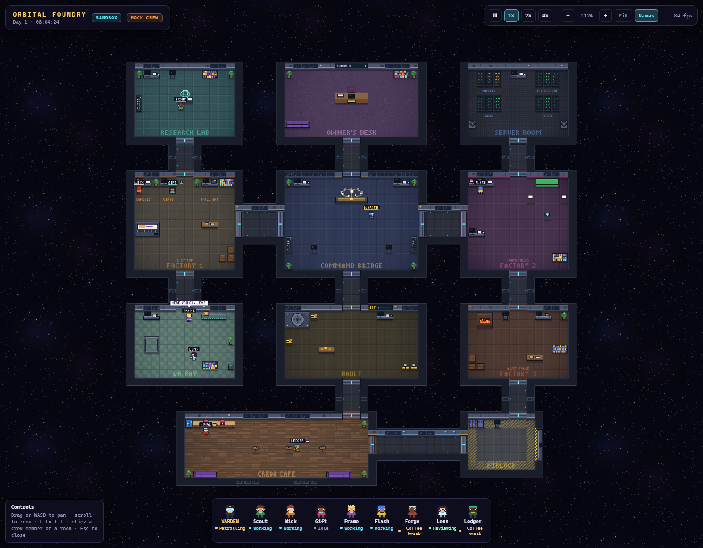

# Orbital Foundry

An always-on pixel-art space station where AI agents run small online businesses: Etsy
print-on-demand, a thumbnail studio and a game-asset forge. The agents answer to an Overseer, and
you approve anything that leaves the station.

**Status:** Stage 2 of 11 is built. The model router, rate limits and image clients are in place,
and the station is on screen with a mock crew of nine. The agents get real brains in Stage 4. The
full plan is in [docs/ROADMAP.md](docs/ROADMAP.md).

## Quick start

1. Install Node 22 or newer, then run `npm install`.
2. Run `npm run client` and open http://localhost:5173 to watch the station. It needs no keys:
   a mock director drives the crew, and no models are called.
   - Drag or use WASD to pan, scroll to zoom, and press F to fit the whole station.
   - Click a crew member for the inspector, or a room for its panel.
3. For the model router, fill in `.env` (see `.env.example`).
   - At minimum, set `NVIDIA_API_KEY`.
   - For live-lane images, also set `CLOUDFLARE_ACCOUNT_ID` and `CLOUDFLARE_API_TOKEN`.
4. Run `npm run census` to see which free models actually work.
5. Run `npm run smoke` for one real call per tier and two test images.
6. Run `npm run check` for lint, typecheck and tests.

## Two lanes

NVIDIA's free API is a trial. It's fine for building and testing, but not for producing things we
sell. Every model call therefore names a lane:

- **sandbox:** development and tests. NVIDIA or any other provider. Outputs are never sold.
- **live:** only providers whose terms allow production use. Today that means Cloudflare Workers AI.

The router enforces this; see `docs/DECISIONS.md` (D-001).
